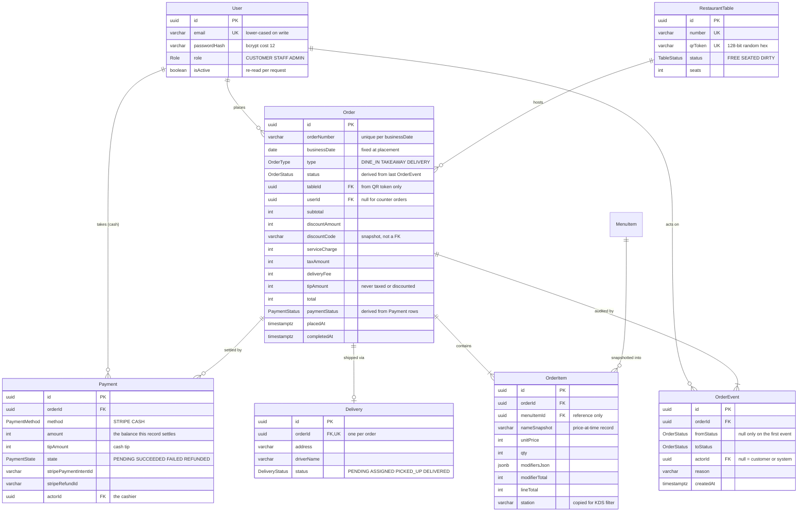
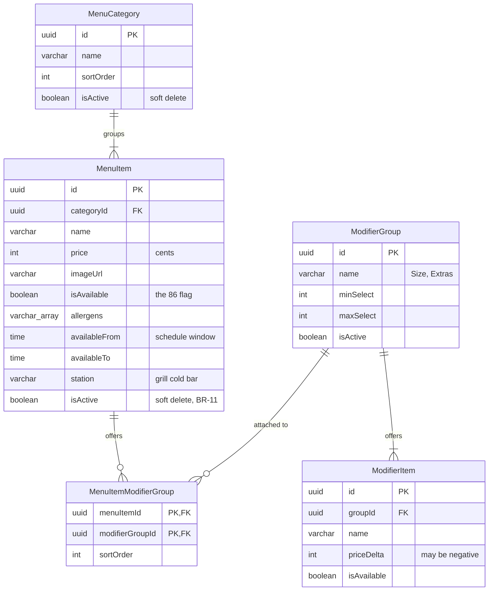
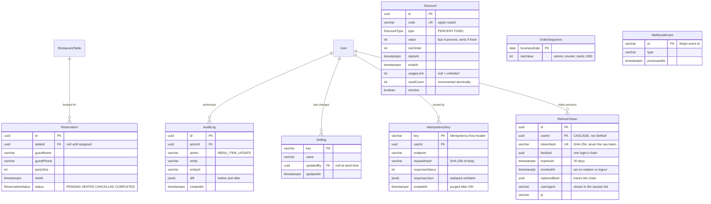

# Entity Relationship Diagram
## Restaurant Ordering System (ROS)

| | |
|---|---|
| **Document ID** | ROS-ERD-001 |
| **Version** | 1.2 |
| **Status** | Draft |
| **Date** | 2026-09-25 |
| **Authority** | **ROS-LLD-001 v1.1 §2 is the source of truth for columns.** This document adds the relational view: cardinality, delete behaviour, indexes, invariants, and the Prisma skeleton. Where the two disagree, the LLD wins and this file is the bug. |

---

## Table of Contents
1. [Reading this document](#1-reading-this-document)
2. [Diagram 1 — Ordering core](#2-diagram-1--ordering-core)
3. [Diagram 2 — Menu & modifiers](#3-diagram-2--menu--modifiers)
4. [Diagram 3 — Operations & infrastructure](#4-diagram-3--operations--infrastructure)
5. [Cardinality reference](#5-cardinality-reference)
6. [Referential actions](#6-referential-actions)
7. [Index inventory](#7-index-inventory)
8. [Constraints beyond the column level](#8-constraints-beyond-the-column-level)
9. [Derived columns — never written directly](#9-derived-columns--never-written-directly)
10. [Prisma schema skeleton](#10-prisma-schema-skeleton)
11. [Decision: money column type](#11-decision-money-column-type)
12. [Revision history](#12-revision-history)

---

## 1. Reading this document

Diagrams are Mermaid `erDiagram` blocks; they render in GitHub, WebStorm and most Markdown
viewers. The model is split into three diagrams because one seventeen-entity graph is unreadable —
the split is presentational, not architectural.

Attributes shown are the **identifying and relational** ones plus whatever makes the entity legible.
Full column lists, types and notes live in LLD §2.2 and are deliberately not duplicated here.

Three things in this model are unusual enough to state up front, because each one exists to solve a
specific bug and reads like a mistake if you do not know why:

- **`Order.orderNumber` is not globally unique.** The daily counter recycles, so uniqueness is
  `(businessDate, orderNumber)`. A global constraint rejects the first order of day two.
- **`Discount` has no foreign key from `Order`.** The code is *snapshotted* onto the order, so
  editing or deleting a discount never rewrites historical totals.
- **Money columns are `integer` cents, not a decimal type.** See §11 and ADR-004.
- **`Payment` carries no webhook-dedupe constraint.** That job belongs to `WebhookEvent.id` alone.
  Two dedupe mechanisms means one of them eventually goes unchecked.

---

## 2. Diagram 1 — Ordering core

The transactional heart. Everything here is written inside a transaction and never edited in place
except through the services named in LLD §4.



> **Naming note.** `Table` is the entity's name throughout the SRS/HLD/LLD, but it is a reserved word
> in SQL and a Mermaid keyword. The diagram calls it `RestaurantTable`; the Prisma model stays
> `Table` with `@@map("Table")`, and raw SQL always quotes it as `"Table"`.

**Two order lifecycles run in parallel and never touch each other.** `Order.status` moves
`PLACED → … → COMPLETED` (or `CANCELLED`); `Order.paymentStatus` moves
`UNPAID → PARTIALLY_PAID → PAID → REFUNDED`. A refund changes the second and leaves the first alone,
which is why `REFUNDED` does not appear in `OrderStatus` at all (LLD §2.1, BR-07).

---

## 3. Diagram 2 — Menu & modifiers

Read-heavy, admin-written, and the only place in the model with a many-to-many.



**`isAvailable` and `isActive` are different things.** `isAvailable = false` is 86'ing: the item is
on the menu, shown as sold out, back tomorrow (MENU-05). `isActive = false` is a soft delete: gone
from the menu entirely, but the row survives because orders reference it (BR-11).

**`MenuItemModifierGroup` is the reason modifier validation is possible.** The server uses it to
answer "is this modifier actually offered on this item?" — the check that stops a client pricing a
cheap modifier from a different dish (LLD §4.3 `resolveSelections`, AC-17).

---

## 4. Diagram 3 — Operations & infrastructure

Reservations attach to tables; everything else in this diagram stands alone by design.



**`OrderSequence` and `WebhookEvent` are concurrency primitives, not business data.** The first
gives an atomic per-day counter that a text `Setting.value` cannot; the second turns webhook
deduplication into a primary-key insert that either succeeds once or fails, with no read-then-write
race in between.

---

## 5. Cardinality reference

| Parent | Child | Cardinality | FK column | Optional? |
|---|---|---|---|---|
| `User` | `Order` | 1 : 0..* | `Order.userId` | Yes — null for a staff-placed counter order |
| `User` | `OrderEvent` | 1 : 0..* | `OrderEvent.actorId` | Yes — null means customer or system |
| `User` | `Payment` | 1 : 0..* | `Payment.actorId` | Yes — set only for cash |
| `User` | `AuditLog` | 1 : 0..* | `AuditLog.actorId` | Yes |
| `User` | `Setting` | 1 : 0..* | `Setting.updatedBy` | Yes — null for seeded values |
| `User` | `IdempotencyKey` | 1 : 0..* | `IdempotencyKey.userId` | Yes |
| `User` | `RefreshToken` | 1 : 0..* | `RefreshToken.userId` | **No** — a session cannot outlive its user |
| `Table` | `Order` | 1 : 0..* | `Order.tableId` | Yes — dine-in only |
| `Table` | `Reservation` | 1 : 0..* | `Reservation.tableId` | Yes — null until assigned |
| `Order` | `OrderItem` | 1 : 1..* | `OrderItem.orderId` | No — an order without items is invalid |
| `Order` | `OrderEvent` | 1 : 1..* | `OrderEvent.orderId` | No — placement writes the first event |
| `Order` | `Payment` | 1 : 0..* | `Payment.orderId` | Yes — many rows enable split payment |
| `Order` | `Delivery` | 1 : 0..1 | `Delivery.orderId` **UNIQUE** | Yes — delivery orders only |
| `MenuCategory` | `MenuItem` | 1 : 0..* | `MenuItem.categoryId` | No |
| `MenuItem` | `OrderItem` | 1 : 0..* | `OrderItem.menuItemId` | Yes — reference only, never priced from |
| `MenuItem` | `ModifierGroup` | *  : * | via `MenuItemModifierGroup` | — |
| `ModifierGroup` | `ModifierItem` | 1 : 0..* | `ModifierItem.groupId` | No |

**No foreign key exists** from `Order` to `Discount`. `Order.discountCode` is a snapshot string, so
a discount can be renamed, expired or deleted without touching a single historical order.

---

## 6. Referential actions

What survives a delete. This table is the practical answer to "can I remove this row?" and is worth
checking before writing any destructive admin feature.

| Relationship | On delete | Consequence |
|---|---|---|
| `Order` → `OrderItem` | **CASCADE** | Deleting an order removes its lines. Orders are never deleted in practice; `CANCELLED` is the terminal state. |
| `Order` → `OrderEvent` | **CASCADE** | Same. Note SRS §6.3 forbids hard-deleting events, so this path should never run in production. |
| `Order` → `Payment` | **CASCADE** | Same. Deleting a paid order would destroy financial records — do not expose this. |
| `Order` → `Delivery` | **CASCADE** | Delivery detail is meaningless without its order. |
| `MenuCategory` → `MenuItem` | **CASCADE** | Which is exactly why categories are soft-deleted (`isActive=false`) rather than removed. |
| `ModifierGroup` → `ModifierItem` | **CASCADE** | Removing a group removes its options. |
| `MenuItem` → `MenuItemModifierGroup` | **CASCADE** | Attachment rows are pure join data. |
| `MenuItem` → `OrderItem` | **SET NULL** | History survives a deleted dish because the name and price were snapshotted. In practice BR-11 prevents the delete, so this is a safety net rather than a path. |
| `User` → `Order` | **SET NULL** | A deleted account leaves its orders intact and anonymised, satisfying the PII deletion rule in SRS §6.3. |
| `User` → `OrderEvent` / `Payment` / `AuditLog` / `Setting` / `IdempotencyKey` | **SET NULL** | Audit rows outlive the actor. |
| `User` → `RefreshToken` | **CASCADE** | The one deliberate exception to the rule below. A refresh token is a live credential, not a historical record — an orphaned session row is a security hole, so deleting an account destroys its sessions outright. |
| `Table` → `Order` | **SET NULL** | Retiring a table does not erase the meals served at it. |
| `Table` → `Reservation` | **SET NULL** | The booking survives; it just needs reassigning. |

**The pattern.** Anything that is *part of* an order cascades with it. Anything that merely
*references* something nulls out instead, because the referencing row carries its own snapshot and
must survive independently. Nothing uses `RESTRICT`: where deletion should be blocked (menu items
with order history), the rule is enforced in the service layer as a soft delete, where it can return
a useful error instead of a constraint violation.

---

## 7. Index inventory

| Table | Index | Purpose |
|---|---|---|
| `User` | `UNIQUE(email)` | Login lookup; duplicate registration → `409 EMAIL_TAKEN` |
| `Table` | `UNIQUE(number)` | Human identifier |
| `Table` | `UNIQUE(qrToken)` | QR resolution; the hot path on every dine-in scan |
| `MenuItem` | `(categoryId)` | Menu assembly |
| `MenuItem` | partial `(isAvailable)` | 86 filtering on the public menu |
| `Order` | `UNIQUE(businessDate, orderNumber)` | Daily numbering (BR-15) |
| `Order` | `(status)` | KDS board queries |
| `Order` | `(businessDate)` | Every report bucket |
| `Order` | `(placedAt DESC)` | Recent-orders lists |
| `Order` | `(tableId, status)` | "Does this table have open orders?" (BR-08) |
| `Order` | `(userId, placedAt DESC)` | Customer order history |
| `Order` | `(paymentStatus)` | Unpaid-order reconciliation job |
| `OrderItem` | `(orderId)` | Order assembly |
| `OrderEvent` | `(orderId, createdAt)` | Audit timeline, in order |
| `Payment` | `(orderId, state)` | `paidSum` — called on every payment change |
| `Delivery` | `UNIQUE(orderId)` | Enforces 0..1 |
| `Discount` | `UNIQUE(code)` | Promo lookup |
| `WebhookEvent` | PK on `id` | Replay protection (PAY-08) |
| `IdempotencyKey` | PK on `key` | Retry replay (NFR-R5) |
| `RefreshToken` | `UNIQUE(tokenHash)` | The refresh lookup, on every 15-minute renewal |
| `RefreshToken` | `(userId, revokedAt)` | Listing a user's active sessions (AUTH-13) |
| `RefreshToken` | `(familyId)` | Revoking a whole family on reuse detection (AUTH-11) |
| `RefreshToken` | `(expiresAt)` | The nightly purge (AUTH-14) |
| `OrderSequence` | PK on `businessDate` | Atomic daily counter |

Volumes from SRS §6.2: ~120k orders, ~450k order items and ~700k order events per year, retained
seven years. Well within a single Postgres instance; no partitioning is needed for v1.

---

## 8. Constraints beyond the column level

Prisma cannot express `CHECK` constraints in the schema language. Add these by hand in a migration
(`prisma migrate dev --create-only`, then edit the SQL) — they are not optional, because each one
guards a business rule the application could otherwise violate silently.

```sql
-- Daily order numbers recycle; uniqueness is per business date (BR-15).
ALTER TABLE "Order" ADD CONSTRAINT "order_number_per_day"
  UNIQUE ("businessDate", "orderNumber");

-- Takeaway and delivery require a contact name; dine-in does not (DEL-01).
ALTER TABLE "Order" ADD CONSTRAINT "customer_name_when_offsite"
  CHECK ("type" = 'DINE_IN' OR "customerName" IS NOT NULL);

-- Totals never go negative (BR-01).
ALTER TABLE "Order" ADD CONSTRAINT "total_non_negative"
  CHECK ("total" >= 0);

-- A line with no quantity is meaningless.
ALTER TABLE "OrderItem" ADD CONSTRAINT "qty_positive"
  CHECK ("qty" > 0);

-- A modifier group cannot require more choices than it permits.
ALTER TABLE "ModifierGroup" ADD CONSTRAINT "select_range_sane"
  CHECK ("minSelect" >= 0 AND "maxSelect" >= "minSelect");

-- A percent discount above 100% would invert the total.
ALTER TABLE "Discount" ADD CONSTRAINT "percent_within_range"
  CHECK ("type" <> 'PERCENT' OR ("value" > 0 AND "value" <= 10000));

-- Redemptions never exceed the limit (DISC-06).
ALTER TABLE "Discount" ADD CONSTRAINT "usage_within_limit"
  CHECK ("usageLimit" IS NULL OR "usedCount" <= "usageLimit");

-- Payments settle a positive amount; tips are separate and non-negative.
ALTER TABLE "Payment" ADD CONSTRAINT "amount_positive"
  CHECK ("amount" > 0 AND "tipAmount" >= 0);

-- A refresh token cannot expire before it was issued.
ALTER TABLE "RefreshToken" ADD CONSTRAINT "expiry_after_issue"
  CHECK ("expiresAt" > "createdAt");
```

---

## 9. Derived columns — never written directly

Three columns mirror state that is authoritative elsewhere. Writing them by hand is how the model
drifts out of agreement with itself.

| Column | Derived from | Written only by | If you write it directly |
|---|---|---|---|
| `Order.status` | the last `OrderEvent.toStatus` | `transitionStatus` (LLD §4.4), inside one transaction with the event insert | The audit timeline and the status disagree; NFR-R3 is broken and reports contradict the event log |
| `Order.paymentStatus` | Σ `Payment` rows where `state = SUCCEEDED`, against `Order.total` | `syncPaymentStatus` (LLD §4.5) — the single writer | Split payments and amendments start disagreeing; an order can read `PAID` while money is outstanding |
| `Discount.usedCount` | count of successful redemptions | the conditional `UPDATE` inside order placement (LLD §3.3) | Two concurrent checkouts both take the last redemption and `usageLimit` stops meaning anything |

`Order.status` is stored rather than computed for query performance — the KDS filters on it on every
poll, and deriving it per row would mean a correlated subquery over `OrderEvent`. The trade is
acceptable **only** because the write is transactional.

---

## 10. Prisma schema skeleton

Structure and relations, ready to fill in. Column types follow LLD §2.2. Money is `Int` cents (§11).

```prisma
generator client { provider = "prisma-client-js" }
datasource db    { provider = "postgresql"; url = env("DATABASE_URL") }

enum Role              { CUSTOMER STAFF ADMIN }
enum OrderType         { DINE_IN TAKEAWAY DELIVERY }
enum OrderStatus       { PLACED CONFIRMED PREPARING READY SERVED COMPLETED CANCELLED }
enum PaymentStatus     { UNPAID PARTIALLY_PAID PAID REFUNDED }
enum PaymentState      { PENDING SUCCEEDED FAILED REFUNDED }
enum PaymentMethod     { STRIPE CASH }
enum TableStatus       { FREE SEATED DIRTY }
enum DiscountType      { PERCENT FIXED }
enum DeliveryStatus    { PENDING ASSIGNED PICKED_UP DELIVERED }
enum ReservationStatus { PENDING SEATED CANCELLED COMPLETED }

model User {
  id           String   @id @default(uuid())
  name         String   @db.VarChar(120)
  email        String   @unique @db.VarChar(255)
  passwordHash String   @db.VarChar(255)
  phone        String?  @db.VarChar(30)
  role         Role     @default(CUSTOMER)
  isActive     Boolean  @default(true)
  createdAt    DateTime @default(now()) @db.Timestamptz

  orders     Order[]
  sessions   RefreshToken[]
  events     OrderEvent[]
  payments   Payment[]
  auditLogs  AuditLog[]
  settings   Setting[]
  idemKeys   IdempotencyKey[]
}

model Table {
  id       String      @id @default(uuid())
  number   String      @unique @db.VarChar(10)
  seats    Int         @default(4)
  status   TableStatus @default(FREE)
  qrToken  String      @unique @db.VarChar(64)
  isActive Boolean     @default(true)

  orders       Order[]
  reservations Reservation[]
}

model MenuCategory {
  id          String  @id @default(uuid())
  name        String  @db.VarChar(80)
  description String? @db.VarChar(255)
  sortOrder   Int     @default(0)
  isActive    Boolean @default(true)

  items MenuItem[]
}

model MenuItem {
  id            String    @id @default(uuid())
  categoryId    String
  name          String    @db.VarChar(120)
  description   String?   @db.VarChar(500)
  price         Int
  imageUrl      String?   @db.VarChar(500)
  isAvailable   Boolean   @default(true)   // the 86 flag
  allergens     String[]  @default([])
  availableFrom DateTime? @db.Time
  availableTo   DateTime? @db.Time
  station       String?   @db.VarChar(40)
  isActive      Boolean   @default(true)   // soft delete

  category       MenuCategory            @relation(fields: [categoryId], references: [id], onDelete: Cascade)
  modifierGroups MenuItemModifierGroup[]
  orderItems     OrderItem[]

  @@index([categoryId])
  @@index([isAvailable])
}

model ModifierGroup {
  id        String  @id @default(uuid())
  name      String  @db.VarChar(80)
  minSelect Int     @default(0)
  maxSelect Int     @default(1)
  isActive  Boolean @default(true)

  items     ModifierItem[]
  menuItems MenuItemModifierGroup[]
}

model MenuItemModifierGroup {
  menuItemId      String
  modifierGroupId String
  sortOrder       Int @default(0)

  menuItem      MenuItem      @relation(fields: [menuItemId],      references: [id], onDelete: Cascade)
  modifierGroup ModifierGroup @relation(fields: [modifierGroupId], references: [id], onDelete: Cascade)

  @@id([menuItemId, modifierGroupId])
}

model ModifierItem {
  id          String  @id @default(uuid())
  groupId     String
  name        String  @db.VarChar(80)
  priceDelta  Int     @default(0)   // may be negative
  isAvailable Boolean @default(true)

  group ModifierGroup @relation(fields: [groupId], references: [id], onDelete: Cascade)
}

model Order {
  id             String        @id @default(uuid())
  orderNumber    String        @db.VarChar(16)
  businessDate   DateTime      @db.Date
  type           OrderType
  status         OrderStatus   @default(PLACED)   // derived — see §9
  tableId        String?
  userId         String?
  customerName   String?       @db.VarChar(120)
  customerPhone  String?       @db.VarChar(30)
  subtotal       Int
  discountAmount Int           @default(0)
  discountCode   String?       @db.VarChar(40)    // snapshot, not a FK
  serviceCharge  Int           @default(0)
  taxAmount      Int
  deliveryFee    Int           @default(0)
  tipAmount      Int           @default(0)
  total          Int
  currency       String        @default("usd") @db.VarChar(3)
  paymentStatus  PaymentStatus @default(UNPAID)   // derived — see §9
  notes          String?       @db.VarChar(500)
  placedAt       DateTime      @default(now()) @db.Timestamptz
  updatedAt      DateTime      @updatedAt @db.Timestamptz
  completedAt    DateTime?     @db.Timestamptz

  table    Table?       @relation(fields: [tableId], references: [id], onDelete: SetNull)
  user     User?        @relation(fields: [userId],  references: [id], onDelete: SetNull)
  items    OrderItem[]
  events   OrderEvent[]
  payments Payment[]
  delivery Delivery?

  @@unique([businessDate, orderNumber])
  @@index([status])
  @@index([businessDate])
  @@index([placedAt(sort: Desc)])
  @@index([tableId, status])
  @@index([userId, placedAt(sort: Desc)])
  @@index([paymentStatus])
}

model OrderItem {
  id            String  @id @default(uuid())
  orderId       String
  menuItemId    String?
  nameSnapshot  String  @db.VarChar(120)
  unitPrice     Int
  qty           Int
  modifiersJson Json    @default("[]")
  modifierTotal Int     @default(0)
  lineTotal     Int
  notes         String? @db.VarChar(300)
  station       String? @db.VarChar(40)

  order    Order     @relation(fields: [orderId],    references: [id], onDelete: Cascade)
  menuItem MenuItem? @relation(fields: [menuItemId], references: [id], onDelete: SetNull)

  @@index([orderId])
}

model OrderEvent {
  id         String       @id @default(uuid())
  orderId    String
  fromStatus OrderStatus?                   // null only on the first event
  toStatus   OrderStatus
  actorId    String?
  reason     String?      @db.VarChar(200)
  createdAt  DateTime     @default(now()) @db.Timestamptz

  order Order @relation(fields: [orderId], references: [id], onDelete: Cascade)
  actor User? @relation(fields: [actorId], references: [id], onDelete: SetNull)

  @@index([orderId, createdAt])
}

model OrderSequence {
  businessDate DateTime @id @db.Date
  lastValue    Int      @default(1000)
}

model RefreshToken {
  id           String    @id @default(uuid())
  userId       String
  tokenHash    String    @unique @db.VarChar(64)   // SHA-256 hex — never the raw token
  familyId     String    @db.Uuid
  expiresAt    DateTime  @db.Timestamptz
  revokedAt    DateTime? @db.Timestamptz
  replacedById String?
  userAgent    String?   @db.VarChar(200)
  ip           String?   @db.VarChar(45)
  createdAt    DateTime  @default(now()) @db.Timestamptz

  user User @relation(fields: [userId], references: [id], onDelete: Cascade)

  @@index([userId, revokedAt])
  @@index([familyId])
  @@index([expiresAt])
}

model IdempotencyKey {
  key            String   @id @db.VarChar(120)
  userId         String?
  endpoint       String   @db.VarChar(80)
  requestHash    String   @db.VarChar(64)
  responseStatus Int
  responseJson   Json
  createdAt      DateTime @default(now()) @db.Timestamptz

  user User? @relation(fields: [userId], references: [id], onDelete: SetNull)
}

model Payment {
  id                    String       @id @default(uuid())
  orderId               String
  method                PaymentMethod
  amount                Int
  tipAmount             Int          @default(0)
  state                 PaymentState @default(PENDING)
  stripePaymentIntentId String?      @db.VarChar(80)
  stripeRefundId        String?      @db.VarChar(80)
  actorId               String?
  createdAt             DateTime     @default(now()) @db.Timestamptz

  order Order @relation(fields: [orderId], references: [id], onDelete: Cascade)
  actor User? @relation(fields: [actorId], references: [id], onDelete: SetNull)

  @@index([orderId, state])
}

model WebhookEvent {
  id          String   @id @db.VarChar(120)   // Stripe event id — the only dedupe mechanism
  type        String   @db.VarChar(80)
  processedAt DateTime @default(now()) @db.Timestamptz
}

model Delivery {
  id          String         @id @default(uuid())
  orderId     String         @unique
  address     String         @db.VarChar(300)
  addressNote String?        @db.VarChar(120)
  driverName  String?        @db.VarChar(80)
  status      DeliveryStatus @default(PENDING)

  order Order @relation(fields: [orderId], references: [id], onDelete: Cascade)
}

model Reservation {
  id         String            @id @default(uuid())
  tableId    String?
  guestName  String            @db.VarChar(120)
  guestPhone String            @db.VarChar(30)
  partySize  Int
  slotAt     DateTime          @db.Timestamptz
  status     ReservationStatus @default(PENDING)
  notes      String?           @db.VarChar(300)

  table Table? @relation(fields: [tableId], references: [id], onDelete: SetNull)

  @@index([slotAt])
}

model Discount {
  id         String       @id @default(uuid())
  code       String       @unique @db.VarChar(40)
  type       DiscountType
  value      Int                                   // bps if PERCENT, cents if FIXED
  minOrder   Int          @default(0)
  startsAt   DateTime?    @db.Timestamptz
  endsAt     DateTime?    @db.Timestamptz
  usageLimit Int?
  usedCount  Int          @default(0)              // derived — see §9
  isActive   Boolean      @default(true)
}

model Setting {
  key       String   @id @db.VarChar(40)
  value     String   @db.VarChar(200)
  updatedBy String?
  updatedAt DateTime @default(now()) @updatedAt @db.Timestamptz

  user User? @relation(fields: [updatedBy], references: [id], onDelete: SetNull)
}

model AuditLog {
  id        String   @id @default(uuid())
  actorId   String?
  action    String   @db.VarChar(60)
  entity    String   @db.VarChar(40)
  entityId  String   @db.VarChar(64)
  diff      Json
  createdAt DateTime @default(now()) @db.Timestamptz

  actor User? @relation(fields: [actorId], references: [id], onDelete: SetNull)

  @@index([entity, entityId])
  @@index([createdAt(sort: Desc)])
}
```

---

## 11. Decision: money column type

**Settled: `Int` (Postgres `integer`) cents. See [ADR-004](DECISIONS.md#adr-004--money-column-type-int-vs-bigint).**

Integer cents is a fixed-point decimal: `1234` is $12.34, just as a Java `BigDecimal` stores an
unscaled integer plus a scale. The decimal point is added only by the client's money formatter.

LLD §1 specifies `number` for money in TypeScript, and a Postgres `bigint` would have broken that.
Prisma maps `bigint` to a JavaScript `BigInt`, which

- throws on `JSON.stringify`, so every DTO would need a manual conversion;
- can't be mixed with `number` in arithmetic without an explicit cast, and the shared pricing
  engine is entirely `number`-based;
- compares and rounds differently enough to make the `bps()` helper awkward.

A Postgres `integer` holds 2,147,483,647 cents, **$21.47 million on a single row**, which no order
or line total will approach. Aggregates are safe too: Postgres promotes `SUM(integer)` to `bigint`
automatically.

| | `BigInt` | `NUMERIC(12,2)` / `Prisma.Decimal` | **`Int` (chosen)** |
|---|---|---|---|
| Per-row ceiling | 9.2 × 10¹⁸ cents | $9.99 billion | $21.47M |
| TS type | `bigint` | `Decimal` object | `number` |
| Works with shared pricing engine | Casts at every boundary | Rewrite onto decimal.js | Directly |
| `JSON.stringify` | Throws | Serialises as a string | Works |
| Stripe amounts | Convert | Convert to cents | Native |
| Aggregate overflow risk | None | None | None — Postgres promotes `SUM` |

---

## 12. Revision history

| Version | Date | Author | Changes |
|---|---|---|---|
| 1.2 | 2026-09-25 | Dev Team | Money type decided (ADR-004): `bigint` → `int` in the diagrams, `BigInt` → `Int` in the Prisma skeleton; §11 rewritten from an open question to the recorded decision, with `NUMERIC` added to the comparison. |
| 1.1.1 | 2026-09-25 | Dev Team | Fixed Mermaid parse errors: attributes with more than one key must separate them with commas (`FK, UK`, `PK, FK`). Diagram 1 `Delivery.orderId` and diagram 2 `MenuItemModifierGroup` keys corrected. No model change. |
| 1.1 | 2026-09-25 | Dev Team | Added `RefreshToken` (LLD v1.2 §2.2) to diagram 3, the cardinality and referential-action tables, the index inventory, the CHECK constraints and the Prisma skeleton. Its `CASCADE` on delete is the one deliberate exception to the SET NULL rule, documented in §6. |
| 1.0 | 2026-09-25 | Dev Team | Initial ERD derived from LLD v1.1 §2. Three Mermaid diagrams, cardinality and referential-action reference, index inventory, CHECK constraints, derived-column rules, Prisma skeleton, and the open money-type decision. |
